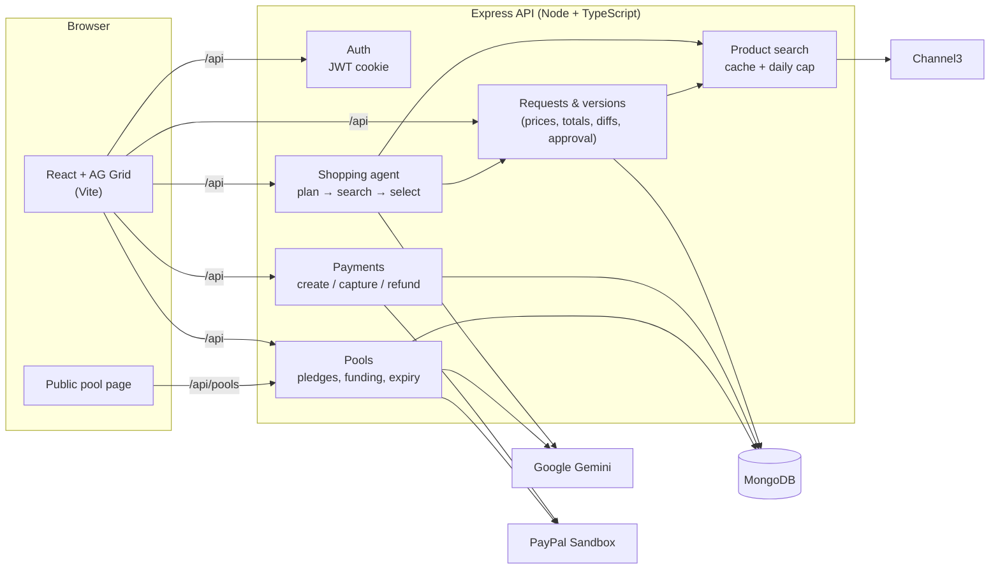
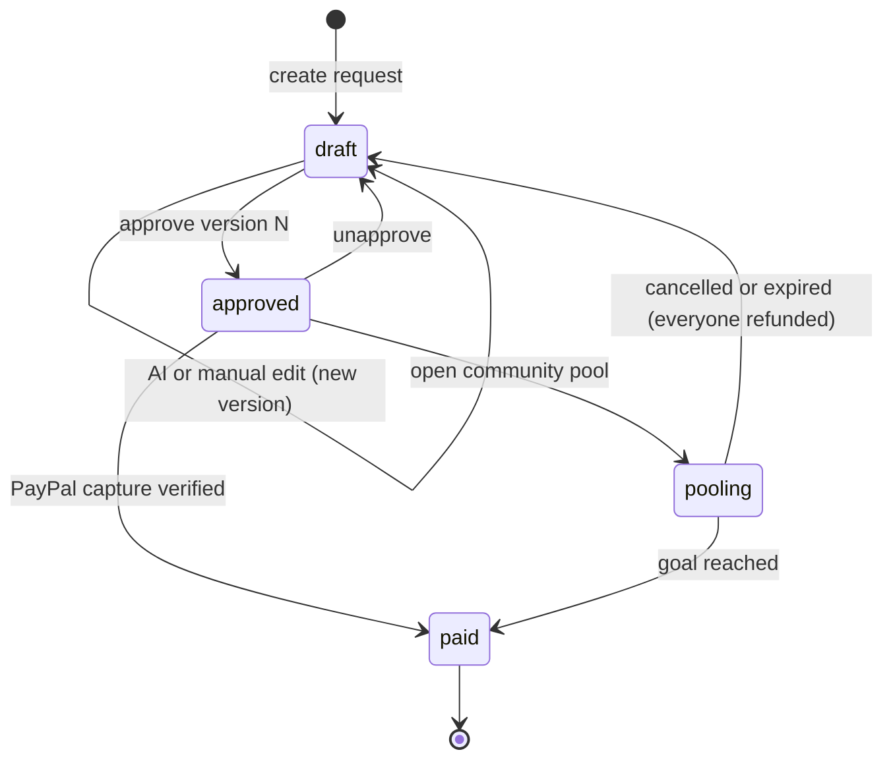

# Nod

**Your agent shops. Your nod pays.**

You tell Nod what you need ("a home office for two engineers under $1,500"). An AI agent finds real products and puts them in a spreadsheet you can edit. When the sheet looks right, you approve it and pay with PayPal. The amount charged is the amount you approved, never anything else.

You can pay on your own, split the cost with a group, or turn it into a community pool that anyone can chip in to.

We built this for the PayPal AI Hackathon. Everything runs in the PayPal Sandbox, so no real money moves.

## Contents

- [Why we built it](#why-we-built-it)
- [How it works](#how-it-works)
- [Paying together: Group Nod](#paying-together-group-nod)
- [Raising it together: community pools](#raising-it-together-community-pools)
- [Where PayPal comes in](#where-paypal-comes-in)
- [Where AI comes in](#where-ai-comes-in)
- [Tools we used](#tools-we-used)
- [Architecture](#architecture)
- [Running it locally](#running-it-locally)
- [Deploying to Render](#deploying-to-render)
- [Trying the demo](#trying-the-demo)
- [Type checking](#type-checking)
- [Project structure](#project-structure)
- [Security](#security)
- [What's missing](#whats-missing)

## Why we built it

Buying a bunch of things for a team, an event or a new flat usually goes like this. You open twenty tabs, copy prices into a spreadsheet, argue about the budget, and then someone pays and chases everyone else for their share.

An AI agent could do the searching. But handing it your card is a bad idea: models make up products and prices, and you can't know in advance what it will charge.

So in Nod the AI does the legwork and you decide what gets paid:

- Prices, stock and totals come from the product catalogue on the server. The model never sets a price.
- Every change, whether from you or the agent, is saved as a new version you can compare with any other.
- You approve one exact version, and checkout charges exactly that. If the sheet changes after you approve it, you have to approve again before you can pay.

## How it works

1. **Describe.** Write what you need and, optionally, a budget.
2. **Generate.** The agent works out what you need, searches a live catalogue through Channel3, picks products and says why it chose each one.
3. **Refine.** Change quantities, remove lines or add products in the AG Grid sheet. Or ask the agent: "upgrade quality", "cut 20%", "add a webcam".
4. **Compare.** Pick any two versions and see what was added, removed or changed, and how the total moved.
5. **Approve.** Approve the version you checked. The sheet is then locked until you unapprove it.
6. **Pay.** You're sent to PayPal to approve the payment, then back to Nod. The server captures the payment and checks the captured amount before marking the request paid.

You can also copy an old version forward as a new draft, see the payment history for each request, and delete requests. Paid requests are kept as a record.

## Paying together: Group Nod

A lot of shopping is shared, with housemates, a team or friends on a trip. Any request can become a group.

The owner shares an invite link, and anyone with an account can join while the request is still a draft (up to 10 people). The owner can revoke the link or remove people.

Everyone has to nod (approve) the same version. If anyone edits the sheet, makes a new version, or someone joins or leaves, all the nods are reset. Nobody pays for a sheet they didn't see.

Once everyone has nodded, the total is split equally. The owner can change the split by percentage, as long as it still adds up to the total. Each person pays their own share through their own PayPal order. The request counts as paid once every share is in. If the owner cancels, any shares already paid are refunded through PayPal.

A solo request is just a group of one, so it works the same way.

## Raising it together: community pools

Sometimes the people paying aren't a fixed group: tents for a scout troop, gloves and bags for a street clean-up, a starter kit for a solar co-op. For those, the owner of an approved solo request can open a **community pool**: a public page that anyone can chip in to.

- **No account needed.** Contributors open the link and pay through PayPal as guests. They can leave their name and a short message, or chip in anonymously.
- **Donors see what they're paying for.** The page shows the approved sheet, read-only. The goal is that sheet's total, and the sheet can't change while the pool is open.
- **AI writes the pitch.** The organiser writes a line about why it matters, and Gemini turns it into a short pitch for the page. If Gemini isn't available, the page uses the organiser's own words and doesn't show the "summarised by AI" badge.
- **Each contribution is a separate PayPal order.** The server won't accept a contribution larger than what's left. When the goal is reached, the pool is funded and the request is marked paid.
- **All or nothing.** If the organiser cancels, or the deadline passes, everyone gets a PayPal refund and the request goes back to draft. A background job checks for overdue pools every minute. If a refund fails, the pool stays open so the refund can be retried.
- **Accessible.** The progress bar and status messages work with screen readers, and the whole form can be used with a keyboard.

## Where PayPal comes in

PayPal is the last step, the one that has to be right. We use the REST APIs on `api-m.sandbox.paypal.com`, with an OAuth client-credentials token.

**Orders v2**
- Each order uses `intent: CAPTURE`, with every product as a line item and an `item_total` equal to the approved total.
- The buyer approves the payment on PayPal's site through the `payer-action` link, and PayPal sends them back to Nod. The order is set to `PAY_NOW` with no shipping.
- The server then captures the order and checks that the captured amount and currency match what was approved. Nothing is marked paid until that check passes.

**Refunds (Payments v2)**
- Cancelling a group payment or a pool refunds each captured payment with `POST /v2/payments/captures/{id}/refund`.

**Retries and errors**
- Every create, capture and refund call sends a `PayPal-Request-Id`, so a retry never charges or refunds twice. An order that's already captured is handled as a success.
- If a card is declined, or the buyer hasn't approved the order yet, they're sent back to PayPal.
- The approval is checked again at checkout and again before capture. If it changed in between, the payment is blocked.

Each payment record keeps the PayPal order ID, capture ID, payer, amount and status, and the app shows all of them.

## Where AI comes in

The shopping agent uses Google Gemini (`gemini-2.5-flash` by default). Every Gemini call asks for structured JSON that matches a schema.

1. **Plan.** Gemini reads the request, the budget, any instruction like "cut 20%", and the current sheet. It returns a list of needs. For each need it either keeps an existing line (maybe with a new quantity) or asks for a search, with a query and an optional price cap.
2. **Search.** The server runs those searches against Channel3 in parallel and keeps up to 6 real products for each need.
3. **Select.** Gemini picks one product per need and writes a one-line reason. It is asked to prefer products that are in stock, under the price cap, within budget and well rated. A rating counts for less when it comes from only a few reviews.
4. **Check and save.** Plain code takes over. It rejects any product ID that didn't come from the search, looks up the real price and stock again, works out the totals and saves a new version.

Gemini also writes the community pool pitch, from the organiser's note and the approved items.

How we keep the model honest:

- Every response is checked against a Zod schema and our own rules: no made-up product IDs, at most 8 searches, and sensible quantities. If a check fails, the errors go back to Gemini for one more try.
- Product text from retailers is marked as untrusted in the prompt, to blunt prompt injection.
- If the agent can't find something, it says so rather than picking something wrong.
- Each user gets 20 AI runs and 50 searches a day. Search results are cached for 15 minutes.
- The model sits behind a small `LlmClient` interface ([`server/src/services/ai/llm.ts`](server/src/services/ai/llm.ts)), so it can be swapped out.

## Tools we used

| Tool | What we used it for |
| --- | --- |
| **PayPal** (Developer + Sandbox) | Orders, captures and refunds for solo, group and pool payments. |
| **Google Gemini** | Planning and picking products for the agent, and writing pool pitches. |
| **Channel3** *(sponsor)* | Live product search and lookup, so every item and price is real. |
| **AG Grid** *(sponsor)* | The editable sheet, the version comparison grid and the My requests list. When the agent changes the sheet, the cells that changed flash, so you can see what it did. |
| **Postman** *(sponsor)* | Testing the REST API and the PayPal sandbox calls while we built them. |
| **Render** *(sponsor)* | Hosting: the API and the React app run as one web service. |
| **MongoDB + Mongoose** | Users, requests, versions, payments, pools and contributions. |
| **Express 5, Node.js, TypeScript** | The API, with Zod validation, Helmet, rate limits and cookie-based JWT auth. |
| **React 19, Vite, TanStack Query, React Router** | The front end. |

We also used GitHub Copilot while writing the code.

## Architecture



### Request lifecycle



`pooling` isn't stored as its own status. The request stays `approved` and locked while its pool is open.

### Data

| Collection | Main fields |
| --- | --- |
| `users` | email, displayName, passwordHash (bcrypt) |
| `procurementrequests` | prompt, budgetCents, status, latestVersion, approvedVersion, members, shares |
| `versions` | number, basedOnVersion, instruction, items (price, stock, rating, link, quantity, reason), totalCents, revision, approval, nods |
| `payments` | paypalOrderId, paypalCaptureId, amountCents, status, payer, capturedAt |
| `pools` | requestId, token, goalCents, story, pitch, deadline, status |
| `contributions` | poolId, name, message, amountCents, paypalOrderId, paypalCaptureId, status, refundId |

Money is always stored as whole cents. Each version has a `revision` number, so an edit or approval made against an out-of-date sheet is rejected.

The full list of endpoints is in [docs/API.md](docs/API.md).

## Running it locally

You'll need:

- Node.js 22 or newer (we used 24)
- MongoDB, either a local `mongod` or a free Atlas cluster
- free keys for:
  - a PayPal sandbox REST app ([developer.paypal.com](https://developer.paypal.com) → Apps & Credentials)
  - Gemini ([aistudio.google.com/apikey](https://aistudio.google.com/apikey))
  - Channel3 ([trychannel3.com](https://trychannel3.com))

The server starts without the keys. Features that need a missing key return `503`.

### Server

```bash
cd server
npm install
cp env.sample .env      # fill in the values
npm run dev             # http://localhost:4000
```

| Variable | Required | Notes |
| --- | --- | --- |
| `MONGODB_URI` | yes | e.g. `mongodb://127.0.0.1:27017/procurement_desk` |
| `JWT_SECRET` | yes | 32+ random characters |
| `CLIENT_ORIGIN` | no | Used for CORS and PayPal return URLs. On Render it defaults to `RENDER_EXTERNAL_URL`, and locally to `http://localhost:5173`. |
| `PORT` | no | default `4000` |
| `PAYPAL_CLIENT_ID`, `PAYPAL_CLIENT_SECRET` | for payments | sandbox app credentials |
| `GEMINI_API_KEY` | for AI | |
| `GEMINI_MODEL` | no | default `gemini-2.5-flash`; it must support JSON schema output |
| `CHANNEL3_API_KEY` | for search | |
| `AI_DAILY_GENERATION_LIMIT` | no | default 20 per user per day |
| `CHANNEL3_DAILY_SEARCH_LIMIT` | no | default 50 per user per day (cache hits are free) |
| `BCRYPT_ROUNDS` | no | default 12 |

### Client

```bash
cd client
npm install
npm run dev             # http://localhost:5173
```

Vite forwards `/api` to the server, so the session cookie works without any CORS setup.

### Production build

```bash
npm run build                   # builds client and server
NODE_ENV=production npm start   # one process serves the API and the app
```

## Deploying to Render

Nod runs as a single Render web service, so the app and the API share one origin and the session cookie just works. [`render.yaml`](render.yaml) sets it up.

1. Create a free MongoDB Atlas cluster and allow access from `0.0.0.0/0`. Render's free tier has no fixed outbound IPs.
2. Push the repo to GitHub.
3. In Render, choose **New → Blueprint** and pick the repo. Render generates `JWT_SECRET` and asks for `MONGODB_URI`, `CHANNEL3_API_KEY`, `GEMINI_API_KEY`, `PAYPAL_CLIENT_ID` and `PAYPAL_CLIENT_SECRET`.
4. Deploy. Render health-checks `/api/health`.

You only need to set `CLIENT_ORIGIN` if you use a custom domain. On the free tier the service sleeps after 15 minutes without traffic, so the first request afterwards can take up to a minute.

## Trying the demo

1. Sign up, then go to **My requests → New request**.
2. Try something like *"Home office for two remote engineers: monitors, keyboards, mice and desk lamps"*, with a budget of 1500.
3. Click **Generate sheet**, then play with it. Ask for "cut 20%", change a quantity, or add a product.
4. Compare two versions to see what changed.
5. Approve a version and click **Pay with PayPal**. Log in with a sandbox personal account (US works best) and approve the payment.
6. Back in Nod, the request shows as paid, with the PayPal order and capture IDs.

**Group:** before approving, click **Invite people** and open the link while signed in as a second user. Both of you nod, adjust the split if you like, and each pay your own share.

**Pool:** approve a solo request and click **Open a community pool** instead of paying. Add a line about why it matters, open the pool and copy the link. Open the link in a private window, which needs no sign-in, and chip in with a sandbox account. **Cancel & refund everyone** sends the money back.

## Type checking

```bash
cd server && npm run typecheck
cd ../client && npm run typecheck
```

## Project structure

```text
client/src/
  api/          fetch wrappers for the API
  components/   SheetGrid, DiffGrid, RequestsGrid (AG Grid), AgentPanel,
                PaymentCard, MembersPanel, PoolPanel, …
  pages/        Home, About, Requests, Request, Join, Pool (public), …
server/src/
  models/       User, ProcurementRequest, Version, Payment, Pool, Contribution
  routes/       auth, products, requests, payments, pools, health
  services/
    ai/                 LlmClient + Gemini
    channel3/           Channel3 client
    paypal/             PayPal client (OAuth, orders, refunds)
    procurementAgent.ts the shopping agent
    requestService.ts   versions, totals, diffs, approval
    paymentService.ts   checkout, capture, group shares
    poolService.ts      community pools
docs/API.md     endpoint reference
render.yaml     Render Blueprint
```

## Security

- Passwords are hashed with bcrypt. Sessions are JWTs in `httpOnly` cookies.
- The API uses Helmet, strict CORS, a 100 KB body limit, and rate limits on login, sign-up and the public pool endpoints.
- Every request body is validated with Zod, and every query is scoped to the signed-in user.
- API keys never leave the server, and prices never come from the browser or the model.
- Public pool pages never show contributors' emails.

## What's missing

- The app runs in the sandbox only, takes USD only, and doesn't handle shipping or tax.
- Nod collects the payment for the approved sheet but doesn't place orders with the retailers. Each line links to the retailer's product page.
- Things we'd add next:
  - payment reminders and email invites for groups;
  - PayPal webhooks for payments that settle later;
  - Payouts, so a funded pool can pay the organiser directly;
  - price-drop alerts from the agent.
