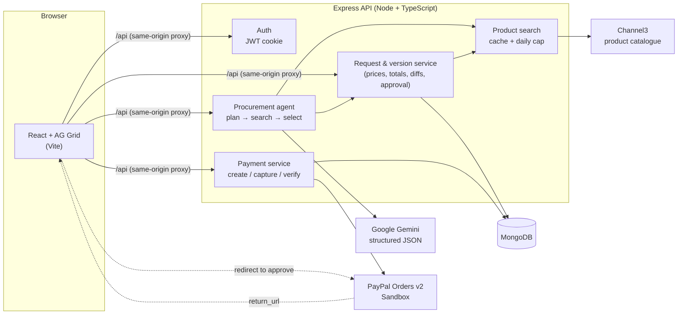
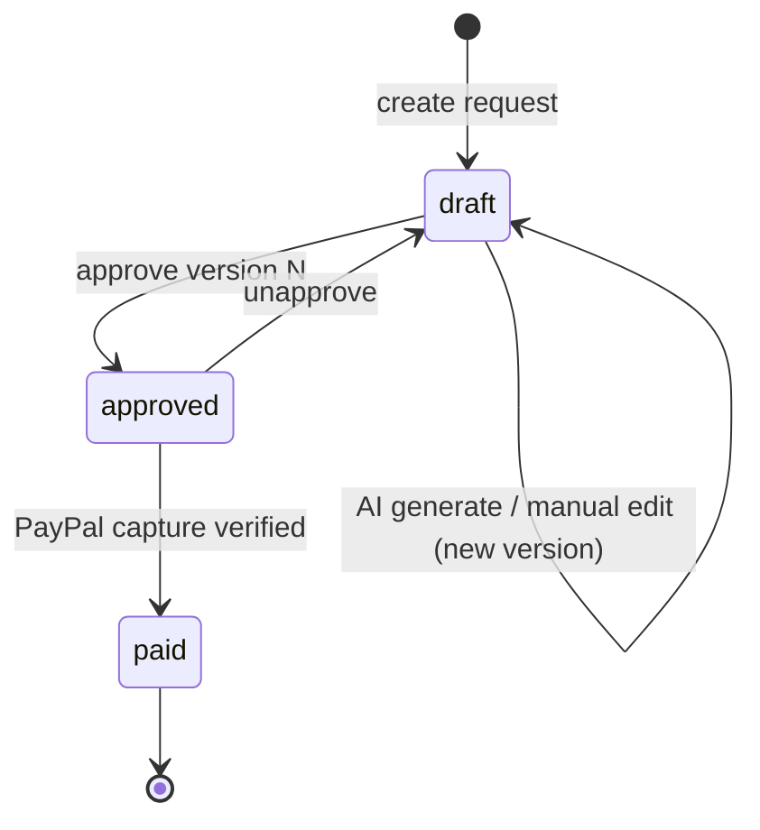

# Nod

**Your agent shops. Your nod pays.**

Nod turns a plain-English request into a paid order: an AI agent sources real products, and PayPal checkout charges only what you approved.

Built for the **PayPal AI Hackathon**.

Describe what you need in plain English, for example *"set up a home office for two engineers under $1,500"*. An AI agent searches real products and builds an editable shopping sheet.

You refine the sheet by editing cells or by telling the agent things like *"upgrade quality"* or *"cut 20%"*. Every change is saved as a new version. When you're happy, you approve one exact version and pay for it with **PayPal**.

The amount charged is always the amount you approved.

> Everything runs in the **PayPal Sandbox**. No real money moves.

---

## Contents

- [The problem](#the-problem)
- [What it does](#what-it-does)
- [How PayPal is used](#how-paypal-is-used)
- [How AI is used](#how-ai-is-used)
- [Tools and sponsor technologies](#tools-and-sponsor-technologies)
- [Architecture](#architecture)
- [Running it locally](#running-it-locally)
- [Deploying to Render](#deploying-to-render)
- [Trying the demo](#trying-the-demo)
- [Testing](#testing)
- [Project structure](#project-structure)
- [Security and safety](#security-and-safety)
- [Limitations and next steps](#limitations-and-next-steps)

---

## The problem

Buying a set of things for a team, an event or a new office is tedious. You:

1. research products across many sites;
2. copy prices into a spreadsheet;
3. haggle over the budget;
4. finally pay.

"Just let an AI buy it" is risky, because AI can invent products and prices, and you can't tell what it will charge.

Nod keeps the AI doing the legwork, while **you stay in control of exactly what gets paid**:

- **The AI proposes, deterministic code validates.** Prices, totals and stock always come from the product catalogue on the server, never from the model.
- **Every change is a version.** You can compare any two versions and see what changed.
- **You approve one exact version.** Checkout charges that version's total. If anything changes after approval, payment is blocked until you approve again.

## What it does

| Step | What happens |
| --- | --- |
| **1. Describe** | Create a request with a plain-English prompt and an optional budget. |
| **2. Generate** | The AI agent plans the needs, searches a live catalogue through **Channel3**, picks the best products and writes a reason for each pick. |
| **3. Refine** | Edit quantities, remove lines or add products by hand in an **AG Grid** sheet. Or ask the agent to revise, for example *"upgrade quality"*, *"cut 20%"* or *"add a webcam"*. |
| **4. Compare** | Every change creates a new version. The version timeline shows each version, and the diff panel shows added, removed and changed lines and the total delta. |
| **5. Approve** | Approve the exact version you reviewed. The request is locked against further edits until you unapprove it. |
| **6. Pay** | Check out with **PayPal**. You're redirected to the PayPal Sandbox, approve the payment and come back. The server captures the order and checks that the captured amount matches. |

Other features:

- sign up and sign in;
- a list of your requests;
- deleting requests (paid requests are kept as a payment record);
- copying any old version forward as a new draft;
- payment history per request.

## How PayPal is used

PayPal is the final, trust-critical step: it turns an approved AI-built sheet into a real (sandbox) order.

- **PayPal Orders API v2** (`api-m.sandbox.paypal.com`), via the REST API with OAuth 2.0 client credentials.
  - **Create order:** `intent: CAPTURE`, with the full **line-item breakdown**: every product, its unit price and quantity, and an `item_total` that matches the approved version's total to the cent.
  - **Redirect checkout:** the buyer approves on PayPal's own site using the `payer-action` link, then returns to `/requests/:id/checkout/return`. The order uses `user_action: PAY_NOW` and `shipping_preference: NO_SHIPPING`.
  - **Capture order:** the server captures the order after the buyer approves it.
- **Idempotency:** order creation and capture both send a `PayPal-Request-Id`. For creation it is derived from the version and approval timestamp, so retries never create duplicate orders. Capture is safe to retry, and `ORDER_ALREADY_CAPTURED` is handled.
- **Amount guarantees:** these checks are done on the server, not the client.
  - At checkout: the approval must still match the version's revision and total.
  - At capture: the approval must not have changed since checkout started.
  - After capture: the **captured amount and currency must equal the approved total** before the request is marked paid.
- **Error handling:** declined payment methods (`INSTRUMENT_DECLINED`) and orders not yet approved send the buyer back to PayPal. Cancelled and failed payments are recorded.
- **Payment record:** each payment stores the PayPal order ID, the capture ID, the payer's email and ID, the amount, the status and when it was captured. All of this is shown in the app.

## How AI is used

The agent is a **plan → search → select** pipeline powered by **Google Gemini** (`gemini-2.5-flash` by default). It uses Gemini's **structured JSON output**, with a response schema, at every step.

1. **Plan (Gemini).** Gemini reads the request, the budget, any revision instruction and the current sheet. It returns a list of needs. Each need either **keeps** an existing line (possibly with a new quantity) or **searches** for a new product, with a shopping query and an optional per-unit price cap.
2. **Search (Channel3).** The server runs the searches in parallel against Channel3's live product catalogue. It returns up to 6 candidates per need, with real prices, stock, ratings and retailer links.
3. **Select (Gemini).** Gemini picks one candidate per need. It prefers items that fit, are in stock, are under the price cap and have a better *weighted* rating (ratings with few reviews are discounted). It keeps the total within budget and writes a short reason the buyer can see.
4. **Validate and save (deterministic code).** The server accepts only product IDs that were actually returned by the search, then re-resolves each product from Channel3 to get its price and stock. It recalculates totals and saves the result as a new version, using the same rules as manual edits.

Guardrails around the model:

- **Every output is validated.** Each Gemini response is checked with a Zod schema and with business rules: for example, no invented product IDs, at most 8 searches per run, and valid quantities. If a check fails, the errors are sent back to Gemini for one retry.
- **Prompt-injection hygiene.** Product titles and features from retailers are explicitly treated as untrusted data in the prompts.
- **Honest output.** If the agent can't fill a need, it reports it as *unmet* instead of forcing a bad pick.
- **Usage limits.** Each user has a daily limit on AI generations (default 20) and on Channel3 searches (default 50). Search results are cached for 15 minutes.
- **Swappable model.** The LLM sits behind a small `LlmClient` interface ([`server/src/services/ai/llm.ts`](server/src/services/ai/llm.ts)), so the model can be changed without touching the agent.

## Tools and sponsor technologies

| Tool | Role in the project |
| --- | --- |
| **PayPal Orders v2** (Sandbox) | Creates, approves and captures orders for the exact approved version. |
| **Google Gemini** (`gemini-2.5-flash`) | The procurement agent's planning and selection steps, with structured JSON output. |
| **Channel3** *(sponsor)* | Live product catalogue search and product lookup, so every item, price and stock level is real. |
| **AG Grid** *(sponsor)* | The editable procurement sheet: inline quantity edits, product images, ratings, availability, line totals and row actions. |
| **MongoDB + Mongoose** | Stores users, requests, versions and payments. |
| **Express 5, Node.js, TypeScript** | The REST API, with Zod validation, Helmet, rate limiting and JWT auth in httpOnly cookies. |
| **React 19, Vite, TanStack Query, React Router** | The single-page client. |
| **Vitest + Supertest** | Server test suite. PayPal, Channel3 and Gemini are all faked in tests. |

The AI coding assistant **GitHub Copilot** was also used during development.

## Architecture



### Request lifecycle



### Data model

| Collection | Key fields |
| --- | --- |
| `users` | email, displayName, passwordHash (bcrypt) |
| `procurementrequests` | prompt, budgetCents, status (`draft` / `approved` / `paid`), latestVersion, approvedVersion |
| `versions` | number, basedOnVersion, instruction, summary, items (a snapshot of each product: price, stock, rating, retailer link, quantity, rationale), totalCents, revision, approval |
| `payments` | paypalOrderId, paypalCaptureId, amountCents, status, payer, capturedAt, versionNumber, approvedRevision |

Money is always stored as **integer cents**. Each version has a `revision` counter, so stale edits and stale approvals are rejected; this is optimistic concurrency.

The full endpoint list is in [docs/API.md](docs/API.md).

## Running it locally

### Prerequisites

- **Node.js 22 or newer.** It was developed on Node 24. The server scripts use `--env-file-if-exists`.
- **MongoDB:** a local `mongod`, or a free MongoDB Atlas cluster.
- API credentials, all of which have free tiers:
  - a **PayPal Developer** sandbox REST app (client ID and secret): [developer.paypal.com](https://developer.paypal.com) → Apps & Credentials → Sandbox.
  - a **Gemini** API key: [aistudio.google.com/apikey](https://aistudio.google.com/apikey).
  - a **Channel3** API key: [trychannel3.com](https://trychannel3.com).

The server starts without the three API keys, but those features return `503` until the matching key is set.

### 1. Server

```bash
cd server
npm install
cp env.sample .env      # then fill in the values
npm run dev             # http://localhost:4000
```

Environment variables (see [`server/env.sample`](server/env.sample)):

| Variable | Required | Description |
| --- | --- | --- |
| `MONGODB_URI` | yes | For example `mongodb://127.0.0.1:27017/procurement_desk`, or an Atlas `mongodb+srv://…` URI. |
| `JWT_SECRET` | yes | 32 or more random characters, used to sign session cookies. |
| `CLIENT_ORIGIN` | no | Defaults to `RENDER_EXTERNAL_URL` on Render, otherwise `http://localhost:5173`. Used for CORS and PayPal's return and cancel URLs. |
| `PORT` | no | Defaults to `4000`. |
| `PAYPAL_CLIENT_ID`, `PAYPAL_CLIENT_SECRET` | for checkout | Sandbox REST app credentials. |
| `GEMINI_API_KEY` | for AI | Gemini API key. |
| `GEMINI_MODEL` | no | Defaults to `gemini-2.5-flash`. The model must support JSON output with a response schema. |
| `CHANNEL3_API_KEY` | for search | Channel3 API key. |
| `AI_DAILY_GENERATION_LIMIT` | no | AI generations per user per UTC day. Default 20. |
| `CHANNEL3_DAILY_SEARCH_LIMIT` | no | Channel3 calls per user per UTC day. Default 50; cache hits are free. |
| `BCRYPT_ROUNDS` | no | Defaults to 12. |

### 2. Client

```bash
cd client
npm install
npm run dev             # http://localhost:5173
```

In development, Vite proxies `/api` to `http://localhost:4000`, so the httpOnly session cookie is same-origin.

### Production build

From the repository root:

```bash
npm run build                   # installs and builds client/ and server/
NODE_ENV=production npm start   # serves the API and client/dist on one port
```

In production the Express server also serves the built React app, so the app and the API share one origin. Client-side routes such as `/requests/:id` fall back to `index.html`, and unknown `/api/*` routes still return JSON 404s.

## Deploying to Render

The app deploys as **one Render web service**. One origin keeps the `sameSite: lax` session cookie working without cross-site cookie or CORS changes. [`render.yaml`](render.yaml) is a Render Blueprint for this setup.

1. Create a free MongoDB Atlas cluster. Under **Network Access**, allow `0.0.0.0/0`, because Render's free tier has no fixed outbound IPs. Copy the connection string, ending in `/procurement_desk`.
2. Push this repository to GitHub.
3. In Render, choose **New → Blueprint** and select the repository. Render reads `render.yaml`, generates `JWT_SECRET`, and asks for the secret values:

   | Variable | Value |
   | --- | --- |
   | `MONGODB_URI` | Atlas connection string |
   | `CHANNEL3_API_KEY` | Channel3 key |
   | `GEMINI_API_KEY` | Gemini key |
   | `PAYPAL_CLIENT_ID` / `PAYPAL_CLIENT_SECRET` | PayPal **Sandbox** app credentials |

4. Deploy. The build runs `npm run build`, the service starts with `npm start`, and Render health-checks `/api/health`.

`CLIENT_ORIGIN` can stay unset: it defaults to Render's `RENDER_EXTERNAL_URL`, which is the URL PayPal sends the buyer back to. Set it only if you add a custom domain.

The free tier sleeps after 15 minutes without traffic, so the first request after that takes up to a minute.

## Trying the demo

1. Open http://localhost:5173 and **sign up**.
2. Go to **My requests → New request**. Enter, for example, *"Home office setup for two remote engineers: monitors, keyboards, mice and desk lamps"*, with a budget of `1500`.
3. Click **Generate sheet**. The agent builds version 1, with a reason for each pick.
4. Try a revision: ask *"cut 20%"* or *"upgrade quality"*. Or edit a quantity in the grid, or add a product with **Add product**.
5. Open the **version timeline** to compare versions and see the diff.
6. **Approve** the version you want, then click **Pay with PayPal**.
7. Log in with a **PayPal Sandbox personal (buyer) account**. You can create one in the developer dashboard; use a **US** account. Approve the payment.
8. You're redirected back. The request is now **Paid**, and the card shows the PayPal order ID, capture ID and payer.

## Testing

```bash
cd server
npm test            # Vitest: 91 tests
npm run typecheck

cd ../client
npm run typecheck
```

The server tests cover:

- authentication;
- product search, including caching and the daily cap;
- the request and version service: edits, revisions, diffs, approval and request deletion;
- the AI agent, with a fake LLM: validation, retries, unmet needs and budget context;
- payments, with a fake PayPal client: idempotency, approval drift, declined payments and amount mismatch.

None of these tests call external services.

## Project structure

```text
.
├── client/                    React + Vite single-page app
│   └── src/
│       ├── api/               typed fetch wrappers for the REST API
│       ├── components/        SheetGrid (AG Grid), AgentPanel, VersionTimeline,
│       │                      VersionDiffPanel, PaymentCard, AddProductDrawer, …
│       ├── pages/             Home, About, Login, Requests, NewRequest,
│       │                      Request (workspace), CheckoutReturn
│       └── assets/            illustrations and tech logos
├── server/                    Express + TypeScript API
│   └── src/
│       ├── config/            env validation (Zod), Mongo connection
│       ├── models/            User, ProcurementRequest, Version, Payment
│       ├── routes/            auth, products, requests, payments, health
│       ├── services/
│       │   ├── ai/            LlmClient interface + Gemini implementation
│       │   ├── channel3/      Channel3 client + product mapper
│       │   ├── paypal/        PayPal Orders v2 client (OAuth, idempotency)
│       │   ├── procurementAgent.ts   plan → search → select pipeline
│       │   ├── requestService.ts     versions, totals, diffs, approval
│       │   └── paymentService.ts     checkout, capture, verification
│       └── *.test.ts          Vitest suites
├── docs/
│   └── API.md                 REST endpoint reference
├── package.json               root build/start scripts used by Render
└── render.yaml                Render Blueprint (one web service)
```

## Security and safety

- Passwords are hashed with bcrypt. Sessions are JWTs in `httpOnly`, `SameSite` cookies.
- Helmet, strict CORS (`CLIENT_ORIGIN` only), a 100 KB JSON body limit, and rate limits on login and registration.
- Every request body is validated with Zod. Every query is scoped to the signed-in user.
- API keys stay on the server. The browser never talks to Gemini, Channel3 or the PayPal REST API directly.
- Prices are never taken from the client or the model, only from Channel3 lookups on the server.
- The payment amount is checked three times: at checkout, before capture and after capture.

## Limitations and next steps

- **Sandbox only:** USD only, and no shipping or tax calculation.
- **Payment, not purchasing.** The PayPal payment represents paying for the approved sheet. The app doesn't place orders with the individual retailers. Each line links to its retailer.
- **Possible next steps:**
  - multi-approver workflows, for example a manager approval step;
  - PayPal payouts or invoicing for reimbursements;
  - webhooks for asynchronous capture states;
  - more AI tools, such as price-drop watching or vendor comparison.
